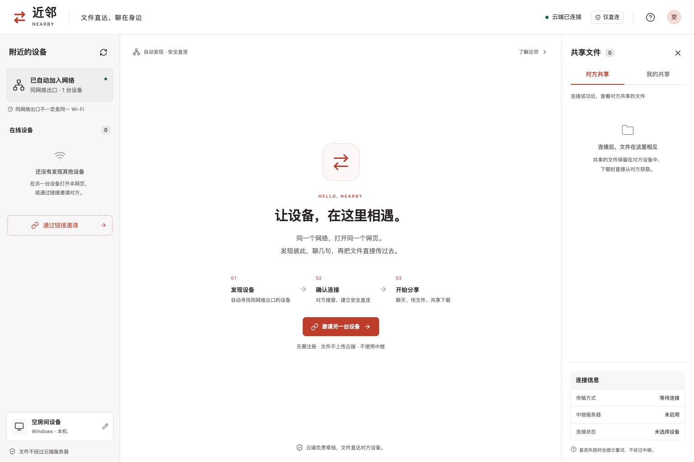

# Nearby · 近邻

[简体中文](README.md) | **English**

Chat and share files directly between devices. Nearby is a browser application built with **Go, a DDD-based modular monolith, React, TypeScript, and WebRTC**.

Open the cloud-hosted website to discover devices sharing the same public network exit. After both users approve a connection, chat messages, shared-file catalogs, and file contents travel directly between browsers over WebRTC DataChannels. **There is no TURN relay, file-upload endpoint, or server-side chat history.**

The application interface is currently in Simplified Chinese.



## Features

- Three-column workspace for devices, conversations, and shared files, with a mobile layout.
- Automatic discovery and temporary rooms based on the public source IP, device names, and online/offline notifications.
- Connection requests, approval, rejection, expiry, cancellation, disconnection, and retry.
- One-to-one chat with application-level delivery acknowledgments and failure states.
- File queues, 16 KiB chunks, backpressure, recipient approval, progress, speed, cancellation, byte-length validation, and downloads.
- Explicit file sharing: approved peers can browse the catalog and download files on demand; sharing can be revoked.
- Random, single-use invitation links valid for 10 minutes, with locally generated QR codes. Invitations can connect devices outside the automatic discovery group; connection approval is still required.
- Online devices and local offline conversation history are shown separately. Devices without conversation or transfer history are removed when they leave.
- WebSocket Origin validation, trusted proxy handling, message-size and rate limits, and room/pairing authorization.
- Frontend assets embedded into a single Go executable, plus Docker deployment with Cloudflare-provided HTTPS and an HTTP origin.

## Development

Requirements: Node.js 22.12+ (24 recommended) and Go 1.24+ (1.26 recommended).

```sh
npm ci
go mod download
npm run build
go run ./cmd/server
```

Open `http://localhost:15789`. This runs a development preview of the cloud service, rather than a separate local deployment mode. Open two browser sessions to test discovery and transfers.

For frontend hot reload, keep Go running, run `npm run dev` in another terminal, and open `http://localhost:5173`. Vite proxies `/api` and WebSocket requests to Go.

Build a standalone executable:

```sh
make build
./bin/nearby
```

Build the frontend before compiling the production Go executable so the embedded assets are current.

## Docker deployment with Cloudflare

```text
Browser HTTPS / WSS → Cloudflare proxy → HTTP / WS → Nearby container :15789
                                         Origin port :15789
Chat and files      → Direct browser-to-browser WebRTC connection
```

The origin serves HTTP only. No local TLS certificate, certificate volume, or Caddy/Nginx certificate service is required. Cloudflare **Flexible** mode provides HTTPS to visitors and uses unencrypted HTTP to the origin. See the [Cloudflare Flexible documentation](https://developers.cloudflare.com/ssl/origin-configuration/ssl-modes/flexible/).

### First deployment

The server needs Bash, curl, Docker Engine, and Docker Compose v2.18+. Node.js and Go are only needed inside the multi-stage image build, not on the host.

1. Point your domain's A record at the origin IP and enable Cloudflare's proxy (orange cloud).
2. Set SSL/TLS encryption mode to **Flexible**, enable **Always Use HTTPS**, and keep **WebSockets** enabled in Network settings. This HTTP-only origin does not use Full or Full (strict) mode.
3. Add an **Origin Rule** matching only `nearby.x-shuffle.com` (or your actual hostname) and override **Destination port** to **15789**. Visitors still use standard HTTPS port 443 without a port in the URL. See [Cloudflare destination port overrides](https://developers.cloudflare.com/rules/origin-rules/features/#destination-port).
4. Place the project on the server and run the command below. The default published HTTP port is 15789. Configure your firewall/security group to allow Cloudflare's official IP ranges to reach that port and prevent direct access around the proxy.

```sh
# Replace this with your actual domain.
./deploy.sh up --domain nearby.your-domain.com
```

The script prepares `.env`, retrieves Cloudflare's official trusted proxy ranges, builds the image, and waits for container health. Access the application at `https://your-domain`; browser P2P features should not be used through the origin's plain HTTP address.

### Management commands

```sh
./deploy.sh init --domain nearby.your-domain.com # Prepare configuration only
./deploy.sh check                              # Validate without starting Docker
./deploy.sh update                             # Rebuild after updating local source
./deploy.sh status                             # Show container status
./deploy.sh logs nearby                        # Follow logs
./deploy.sh down                               # Stop and remove project containers
./deploy.sh refresh-proxies                    # Refresh trusted Cloudflare ranges
./deploy.sh --help
```

Commands can be invoked from any working directory. The script always uses its own project directory and the fixed Compose project name `nearby`, so this setup deploys one instance per Docker engine. The startup wait defaults to 120 seconds; use `./deploy.sh up --timeout 300` to change it.

Existing `.env` configuration is preserved. Only an explicit `--domain` changes the stored domain. The script never executes `.env`, installs Docker, changes firewall rules, fetches project source, or performs global Docker cleanup. Updates replace the application container; signaling sessions reconnect and require pairing again. Startup failures display container status and recent logs.

### Client IPs and discovery

Go trusts only the official ranges supplied through `.env.cloudflare` and parses `X-Forwarded-For` from right to left through the trusted proxy chain. Forged headers from an untrusted source do not change the detected source IP. See [Cloudflare's HTTP header documentation](https://developers.cloudflare.com/fundamentals/reference/http-headers/).

- `init` copies the bundled range snapshot from `.env.cloudflare.example`. `up` and `update` fetch and validate the official IPv4/IPv6 lists. A failed download aborts deployment and preserves the previous proxy configuration.
- `.env.cloudflare` supplies Go's `TRUSTED_PROXIES` through Compose interpolation. Do not replace it with `0.0.0.0/0` or trust arbitrary sources.
- Keep visitor IP headers enabled in Cloudflare. An additional reverse proxy that rewrites the source address needs its own explicit trust configuration.
- This setup targets Linux cloud Docker networking. Extra load balancers, Docker Desktop, or address translation can affect the source address seen by Go; verify it after deployment rather than trusting all addresses.
- Cloudflare may accept IPv6 visitors even when the origin has only an A record. Such devices may not share a discoverable IPv4 exit; use an invitation link. Nearby does not group devices using a guessed IPv6 prefix.
- Go returns `Cache-Control: no-store`. Any additional Cloudflare caching rules should bypass `/api/*`. Interrupted WebSocket connections reconnect automatically. See [Cloudflare's WebSocket documentation](https://developers.cloudflare.com/network/websockets/).

For an existing deployment, set `ORIGIN_HTTP_PORT=15789` in `.env` before updating. The script preserves existing configuration and will not overwrite an older value. This service uses origin TCP port 15789 and does not occupy host port 80.

The deployment configuration is provided, but a real cloud deployment has not yet been verified. Container health checks validate the HTTP origin only; the actual domain, Cloudflare proxy, HTTPS certificate, and visitor IP forwarding still need deployment verification.

Deployment-script tests use simulated Docker commands and do not start or delete real containers:

```sh
python3 -m unittest discover -s tests -p 'test_deploy.py' -v
```

## Configuration

| Variable | Default | Purpose |
| --- | --- | --- |
| `ADDR` | `:15789` | Go listen address |
| `TRUSTED_PROXIES` | Empty for direct execution; supplied by the Docker script | Trusted Cloudflare proxy CIDRs allowed to provide the visitor IP chain |
| `ALLOWED_ORIGINS` | Same origin | Additional WebSocket Origin host patterns; avoid wildcards |
| `DISCOVERY_WS_URL` | Current site's `/api/ws` | Optional `wss://v4.example.com/api/ws`; the discovery endpoint must reach the **same service instance** |
| `STUN_URLS` | Empty | Optional comma-separated, client-reachable `stun:`/`stuns:` URLs; `turn:` URLs are rejected at startup |

Host candidates are used by default, suitable for local networks that allow devices to communicate. STUN discovers possible public addresses and does not relay files. Cross-network invitations do not guarantee connectivity without a reachable STUN server. Nearby never falls back to TURN.

## Network and data boundaries

- **Sharing a public IP does not prove devices are on the same Wi-Fi.** Corporate networks and carrier-grade NAT can group unrelated devices; VPNs, proxies, and IPv6 can prevent discovery. Discovery is not identity verification.
- IPv6 discovery uses the full source address, not a guessed `/64`. Use an appropriate IPv4 discovery route or an invitation when necessary.
- Room keys are HMACs of the source IP using a random process secret. Raw source IPs are not included in discovery events, although the server processes source IPs and WebRTC signaling can contain network information.
- Peers cannot exchange WebRTC signaling before pairing is accepted. Shared catalogs are sent only through established direct connections.
- A direct connection is not necessarily a LAN connection. The UI does not claim confirmed same-Wi-Fi connectivity based on candidate types.
- Wi-Fi client isolation, firewalls, VPNs, and browser policies can block direct connections. Negotiation times out after 20 seconds with an explicit retry message.
- **The first version limits individual files to 256 MiB and the page's total retained/in-progress incoming files to 256 MiB.** Incoming files use memory. Save and then release them to free the receive area. Streaming to disk and resumable transfers are not implemented.
- Chat history, unsaved incoming files, and shared-file selections belong to the current page session and are cleared by refresh or closing the page. Offline conversation history is local to that page, not shared with new visitors. Browser downloads handle saving; received files are not opened automatically.
- Established P2P channels can continue during a temporary signaling outage. Registering a new cloud session assigns a fresh identity, closes previous connections, and requires new pairing.
- Server state is in memory in a single instance. Restarting clears rooms and pairings. Multiple replicas require shared state and cross-instance message routing; adding a load balancer alone is insufficient.

## DDD structure

```text
cmd/server/                         Startup, configuration, dependency wiring
internal/discovery/domain/         Device entity and naming rules
internal/room/domain/              Room aggregate and member capacity
internal/pairing/domain/           Pairing aggregate, state machine, authorization
internal/session/application/      Cross-domain use cases, repository interface, events
internal/session/infrastructure/   In-memory repository
internal/interfaces/httpapi/       HTTP/WebSocket adapters, source IPs, delivery
web/src/                          React UI and browser P2P client
web/embed.go                      Embedded frontend assets
```

The domain layer does not depend on HTTP, WebSocket, the UI, or a concrete repository. The application layer coordinates domain objects and returns transport-independent delivery events. Repository operations are serialized in memory, and the network adapter preserves event delivery order. Chat and file data channels live in browsers; the Go service does not create server-side chat records or file-storage aggregates.

## Verification

```sh
go test -race ./...
npm run build
npx playwright install chromium
npm run test:e2e
```

To use an installed Chrome binary, set `PLAYWRIGHT_CHROMIUM_EXECUTABLE` to its absolute path.

Backend tests cover pairing states, expiration, room isolation, cross-room invitations, single-use links, disconnect cleanup, unauthorized signaling, spoofed proxy headers, Cloudflare visitor IP forwarding, and WebSocket Origin validation. Browser tests establish real WebRTC connections between independent sessions, compare downloaded bytes, verify chat acknowledgments, and confirm that WebSocket frames do not contain chat bodies or file names.

Browser automation runs on one development host. Cloud network access, connections across routers, and physical iOS/Android device compatibility still need verification after deployment.
